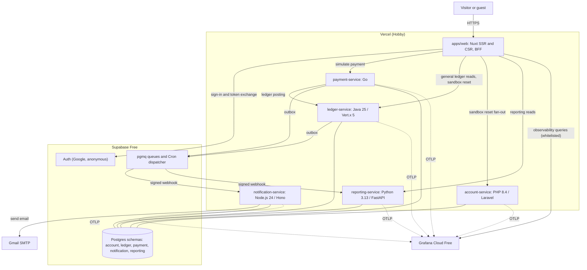

# gradi-playground

Portfolio engineering lab: polyglot microservices, OAuth2, SSR/CSR, observability and spec-driven AI development. Work in progress.

This repository is a **design and specification stage**. It holds decisions (ADRs), contracts, specs and stub documentation. Application code arrives later, one OpenSpec change at a time.

## What this demonstrates

- Five services in five runtimes, each with its own language, framework and migration tool.
- Database per service through schema isolation on one free Postgres project.
- Event-driven integration: transactional outbox, queues, signed webhooks, retries, dead-letter queue and replay.
- OAuth2 and OpenID Connect with Google, PKCE, a server-side BFF, guest users and self-validating resource servers.
- Hybrid rendering: an SSR main page and a CSR playground in one Nuxt app.
- Observability with OpenTelemetry, Grafana Cloud and native charts served through whitelisted queries.
- A double-entry ledger with a general ledger report and a trial balance.
- Simulated DC/DRC failover and per-user sandbox reset.
- Spec-driven development with OpenSpec and guardrails for AI coding agents.

## Services

| Service | Language / framework | Schema | Migration tool | Responsibility |
|---|---|---|---|---|
| account-service | PHP 8.4 / Laravel | `account` | Laravel migrations | Customer sandbox accounts and balances |
| ledger-service | Java 25 / Vert.x 5 (Maven) | `ledger` | Flyway | Double-entry journal, general ledger, trial balance |
| payment-service | Go | `payment` | golang-migrate | Simulate payments, orchestrate posting, emit payment events |
| notification-service | Node.js 24 / TypeScript + Hono | `notification` | Drizzle Kit | Consume events via webhook, send real email |
| reporting-service | Python 3.13 / FastAPI (uv) | `reporting` | Alembic | Read model of cross-service summaries built from events |

The web app `apps/web` (Nuxt) hosts the main page and the playground, and its BFF.

## Architecture



Details: [C4 diagrams](architecture/c4/README.md), [ADR index](architecture/adr/README.md).

## Event flow

A payment writes its event to an outbox in the same transaction as the change. A trigger publishes it to one pgmq queue per consumer group. A Cron dispatcher POSTs HMAC-signed CloudEvents to each consumer. A 2xx response acknowledges the event; failures are retried with backoff, then moved to a dead-letter queue. Consumers are idempotent through an inbox table, and archived messages can be replayed. See [ADR 0005](architecture/adr/0005-kafka-like-events-with-pgmq-and-webhooks.md) and the [event contracts](contracts/events/README.md).

## Authentication

Supabase Auth is the authorization server and Google is the identity provider, using Authorization Code with PKCE. The Nuxt BFF exchanges the code on the server and keeps tokens in `httpOnly` cookies. Each service validates the JWT itself through JWKS. Visitors start as guests and keep their data when they sign in with Google. See [ADR 0007](architecture/adr/0007-oauth2-oidc-with-supabase-auth.md) and the [auth model](docs/security/auth.md).

## Routes

| Route | Rendering | Content |
|---|---|---|
| `/` | SSR | Main page about the owner, link to the playground |
| `/playground` | CSR | Hub with Payment and Dashboards |
| `/playground/payment` | CSR | Payment form, live timeline, general ledger, DC/DRC panel, reset to seed |
| `/playground/dashboards` | CSR | Native charts, logs panel, link to Grafana |

See [ADR 0008](architecture/adr/0008-hybrid-rendering-ssr-and-csr.md).

## Observability

Every service pushes metrics, logs and traces over OTLP to Grafana Cloud Free (locally, to a `grafana/otel-lgtm` container). Every signal carries `service.name`, `deployment.environment` and `deployment.site`, and logs are correlated with traces. Grafana Cloud Free blocks iframe embedding, so the playground draws its own charts from whitelisted queries served by the BFF. See [ADR 0009](architecture/adr/0009-opentelemetry-and-grafana-cloud.md) and [ADR 0010](architecture/adr/0010-native-observability-charts-via-bff.md).

## DC/DRC failover (simulated)

Each service is deployed once. DC and DRC are logical sites: a topology panel toggles services on and off per site, and a router switch selects the site that carries each transaction. A service that is off for the requested site returns `503` with `Retry-After`, so the transaction fails at that hop; switching to DRC lets it succeed. This is a simulation on one shared database. See [ADR 0012](architecture/adr/0012-simulated-dc-drc-failover.md).

## Repository layout

```text
gradi-playground/
├── apps/
│   └── web/                      Nuxt app: SSR main page, CSR playground, BFF
├── services/
│   ├── account-service/          PHP 8.4 / Laravel
│   ├── ledger-service/           Java 25 / Vert.x 5
│   ├── payment-service/          Go
│   ├── notification-service/     Node.js 24 / Hono
│   └── reporting-service/        Python 3.13 / FastAPI
├── supabase/                     Platform layer: auth, schemas and roles, queues, cron
├── contracts/
│   ├── openapi/                  OpenAPI 3.1 stubs per service
│   └── events/                   AsyncAPI 3.0 and JSON Schema for events
├── infrastructure/
│   ├── docker/                   Compose local stack
│   ├── kubernetes/               kind manifests
│   ├── terraform/                Vercel and Supabase providers (owner applies)
│   ├── ansible/                  Reserved for future VM provisioning
│   └── observability/            OTel, Grafana Cloud and dashboards as code
├── architecture/
│   ├── adr/                      Architecture decision records (0001-0014)
│   ├── c4/                       C4 context and container diagrams
│   ├── diagrams/                 Other diagrams (Mermaid)
│   └── decisions/                Lightweight decision log
├── openspec/                     System-level specs and cross-service changes
├── docs/                         API, database, security, SRE, postmortems
├── load-tests/                   k6 scenarios (planned)
├── .github/                      Secret scan workflow, Dependabot, PR template
├── .claude/                      Claude Code settings (deny rules) and skills
├── CLAUDE.md                     Guidance for coding agents
└── LICENSE                       MIT
```

Each service folder also contains its own `openspec/` with service specs and changes.

## How work is done

Every feature starts as an OpenSpec change: a proposal, then implementation of the listed tasks only, then archive. One pull request per change. Architectural changes need an ADR. Guardrails exist in two layers: soft rules in the OpenSpec configs and `CLAUDE.md`, and hard deny rules in `.claude/settings.json` that block the most dangerous commands. Secrets are scanned in CI with gitleaks. See [ADR 0013](architecture/adr/0013-spec-driven-development-with-openspec.md).

## Roadmap

Items are delivered one OpenSpec change at a time.

| # | Item | Status |
|---|---|---|
| 1 | Supabase platform layer: config, Google and anonymous auth, schemas and roles bootstrap, pgmq queues and dispatcher, cron cleanup | Done |
| 2 | `apps/web`: SSR main page, CSR playground hub, guest and Google PKCE flow, BFF basics | Done |
| 3 | One pull request per service: skeleton, JWT middleware, own migrations, Dockerfile, CI, Vercel project | In progress (payment-service and ledger-service done) |
| 4 | Eventing end to end (outbox, pgmq, dispatcher, consumers, DLQ and replay) and real email | Planned |
| 5 | Payment playground: timeline, general ledger section, DC/DRC panel, reset to seed | Planned |
| 6 | Observability: OTel in each service, `otel-lgtm` in Compose, Grafana Cloud, dashboards as code, dashboards page | Planned |
| 7 | Infrastructure: Compose, kind, Terraform, k6 load tests, PreToolUse hook restricting edits to the active service folder | Planned |

## Hosting and free tiers

- **Vercel Hobby**: one project per service using the Container runtime (beta), and the Nuxt app natively. Fallback host: Render free web service.
- **Supabase Free**: one active project holds all schemas (a second project is reserved for staging).
- **Grafana Cloud Free**: 10k active series, 50 GB logs, 50 GB traces, 14-day retention.
- **Gmail SMTP**: capped well below the daily sending limit (100 emails per day globally).

The guardrails require staying within these quotas.

## Documentation

- [Architecture decision records](architecture/adr/README.md)
- [API contracts](contracts/README.md) and [docs/api](docs/api/README.md)
- [Database ownership](docs/database/README.md)
- [Security and auth model](docs/security/README.md)
- [SRE notes](docs/sre/README.md) and [postmortem template](docs/postmortems/TEMPLATE.md)
- [Security policy](SECURITY.md)

## License

MIT. See [LICENSE](LICENSE).
