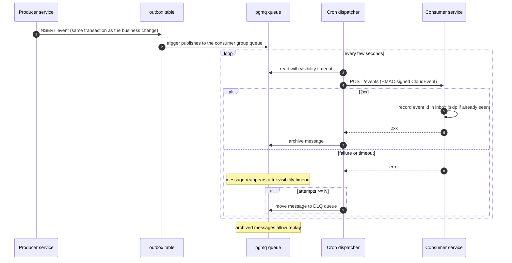

# 0005. Kafka-like events with pgmq and webhooks

- Status: Accepted
- Date: 2026-11-21

## Context

Services must react to each other's changes (payment outcomes drive ledger, notification and reporting) without direct coupling. The project should show Kafka-style concepts: producers, consumer groups, retries, dead-letter queues and replay. It must run inside the free Supabase tier, with no extra vendor.

## Decision

- A producer writes its event to its own `outbox` table in the same transaction as the business change.
- A trigger publishes each outbox row to Supabase Queues (pgmq), with one queue per consumer group, for example `payment.events.notification` and `payment.events.reporting`.
- A Supabase Cron dispatcher runs every few seconds. It reads messages with a visibility timeout and POSTs HMAC-signed CloudEvents to each consumer's `POST /events`.
  - A 2xx response acknowledges the message; it is archived.
  - Any failure makes the message reappear after the visibility timeout, and it is retried with backoff.
  - After N attempts the message is moved to a dead-letter queue (DLQ).
  - Archived messages allow replay.
- Consumers are idempotent. Each consumer keeps an `inbox` table of processed event ids, so at-least-once delivery is safe.
- Events carry `site` (DC or DRC) and the W3C trace context.
- Contracts are AsyncAPI 3.0 and JSON Schema, using a CloudEvents 1.0 envelope and versioned names such as `payment.succeeded.v1`.

## Consequences

### Positive

- Delivery guarantees are explicit (at-least-once, idempotent consumers) and testable.
- Retries, DLQ and replay are visible in the playground timeline and dashboards.
- Runs on Supabase Free without an additional vendor.

### Negative

- Delivery latency is bounded below by the dispatcher interval (a few seconds).
- The dispatcher is custom code that must be operated and monitored (DLQ size and event delivery lag are SLIs).
- Ordering is per queue and not guaranteed across consumer groups.

## Alternatives considered

- **Plain Supabase Database Webhooks**: rejected, because they offer no retry queue or DLQ.
- **Upstash QStash**: rejected, because it adds a vendor and a quota.
- **Apache Kafka or Redpanda**: rejected, because a hosted broker does not fit the free-tier constraint.
