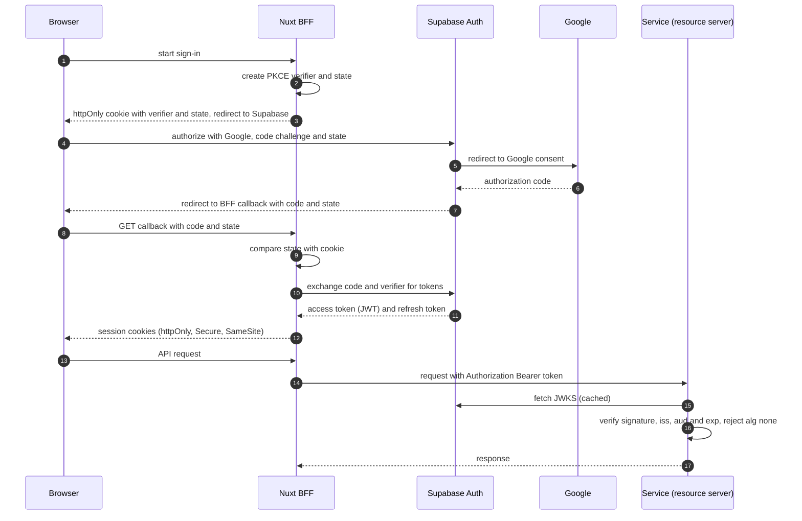
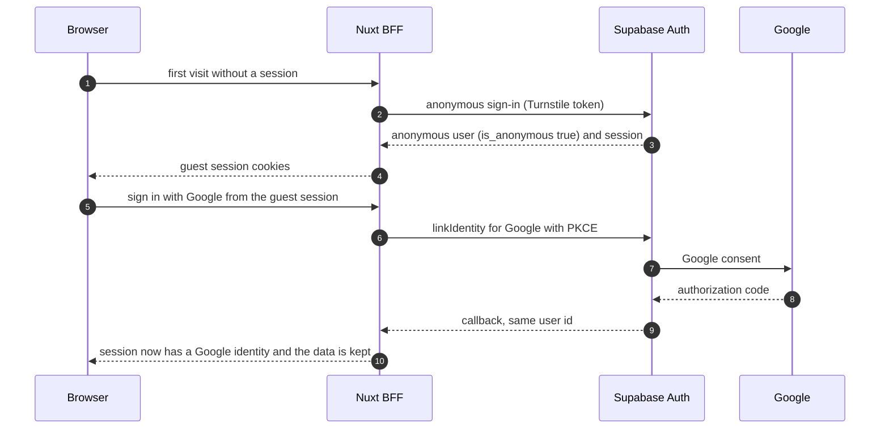

# 0007. OAuth2/OIDC with Supabase Auth and guest users

- Status: Accepted
- Date: 2026-11-21

## Context

The playground should demonstrate real OAuth2 and OpenID Connect: an authorization server, a client, resource servers that validate tokens themselves, and Google as an external identity provider. Visitors should be able to use the playground without an account, but signing in with Google must keep their data. End users should never need a Supabase account.

## Decision

- **Authorization server**: Supabase Auth. End users live in the project's `auth.users`; no Supabase account is needed to use the playground.
- **Identity provider**: Google, through the Authorization Code flow with PKCE.
- **Client**: the Nuxt BFF (`apps/web`). It exchanges the code and verifier on the server, so the browser never sees the authorization code exchange or a refresh token.
- **Session**: stored in `httpOnly`, `Secure` and `SameSite` cookies. Never in `localStorage`. Refresh is handled by the BFF; logout revokes the session.
- **Resource servers**: every service validates the JWT itself via JWKS, checking signature, `iss`, `aud` and `exp`, and rejecting `alg: none`.
- **Guest by default**: a visitor without a session gets a per-visitor anonymous user (`is_anonymous: true`, shown as "guest"). Anonymous sign-in is protected by Cloudflare Turnstile.
- **Upgrade**: Google sign-in from a guest session uses `linkIdentity`, which keeps the same user id and data.
- **Cleanup**: stale guests (inactive for more than 30 days) are removed nightly.
- **Later (roadmap)**: incremental Google scope and a call to a Google API with the `provider_token`, to demonstrate delegated authorization.

### Login flow

### Guest upgrade flow

## Consequences

### Positive

- Standard protocols that map directly to the OAuth2 roles, so the design is easy to explain and audit.
- Tokens never reach browser JavaScript; the BFF keeps the refresh token.
- Guests can try the playground immediately, and their data survives sign-in.

### Negative

- Supabase Auth is a managed authorization server; its behaviour is partly outside the project's control.
- Each service needs a JWT library and JWKS caching, which is repeated in five languages (see [auth notes](../../docs/security/auth.md)).
- Anonymous users accumulate; nightly cleanup and the Turnstile guard limit the growth.

## Alternatives considered

- **Implicit flow**: rejected. It exposes tokens in the browser and is deprecated for SPAs; PKCE with a server-side BFF is the current recommendation.
- **Session-only login with no OAuth2**: rejected, because the point is to demonstrate OAuth2 and OIDC.
- **Self-hosted Keycloak**: rejected for hosting weight on free tiers.
- **Requiring a real account for every visitor**: rejected for friction; guests keep the playground open.
