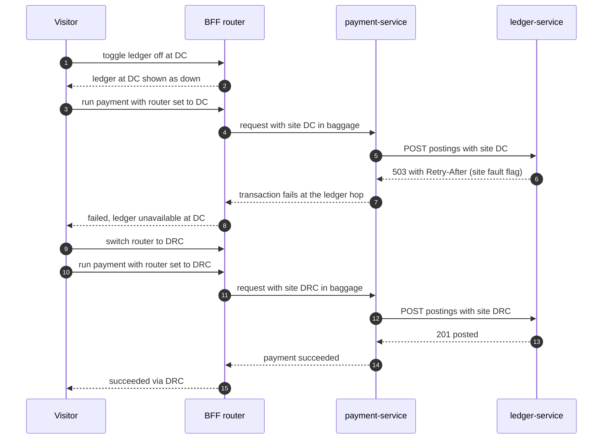

# 0012. Simulated DC/DRC failover

- Status: Accepted
- Date: 2026-11-21

## Context

A common topic in resilience engineering is a primary datacenter (DC) failing over to a disaster-recovery site (DRC). The playground cannot afford two real deployments of five services, and the free database cannot replicate across regions. The behaviour must still be visible and explainable: a request fails when its site is down and succeeds when the router moves to the other site.

## Decision

- Each service is deployed once. DC and DRC are **logical sites**, not separate deployments.
- The topology panel shows two columns (DC and DRC) with five service nodes each. Clicking a node toggles it on or off for the site. A router switch selects DC or DRC. State is per user (ADR 0011 resets it).
- The BFF acts as the global traffic router. It sets `site=DC` or `site=DRC` in W3C `baggage` together with `traceparent`.
- Services forward `site` on outbound calls, with same-site affinity (payment at DC calls ledger at DC).
- A service that is toggled off for the requested site returns `503` with `Retry-After`. The transaction fails at that hop.
- Switching the router to DRC makes the same transaction succeed, because the DRC nodes are on.
- All telemetry carries `deployment.site` (ADR 0009).

The sequence below shows a DC failure at the ledger hop and the router switch to DRC.

## Consequences

### Positive

- Failover behaviour is visible, repeatable and testable with the topology panel and load tests.
- The fault flag and `Retry-After` behaviour are part of every service's baseline spec.

### Negative

- This is a simulation: a single shared database has no cross-region replication, so the DRC is not a real disaster-recovery site.
- Automatic failover is not implemented; the user switches the router manually.
- The `site` flag must be forwarded everywhere, which is an easy place for bugs.

## Alternatives considered

- **Two real deployments of every service**: rejected, because it doubles hosting and is not possible on the free tiers.
- **Automatic health-based failover**: deferred; it needs real health checks across sites and is listed as a later enhancement.
- **No failover demonstration**: rejected, because resilience is one of the project's stated topics.
