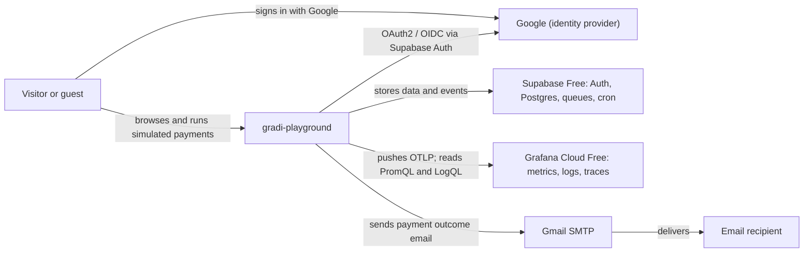
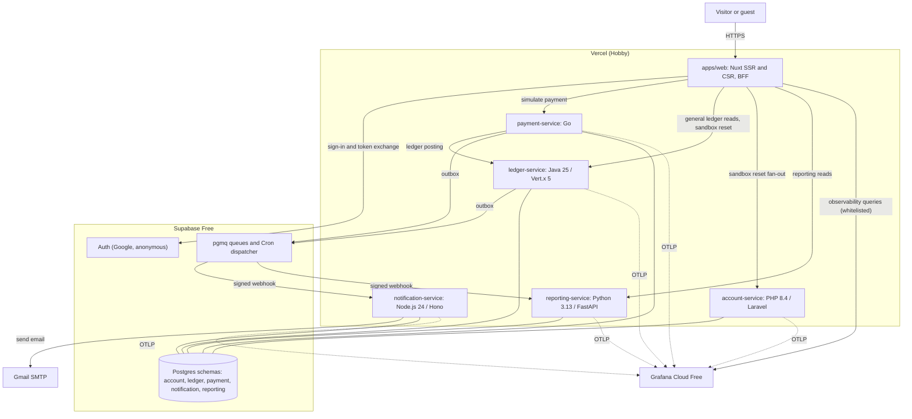

# architecture/c4

C4 model diagrams for gradi-playground: the system context and the container view. The diagrams use Mermaid `flowchart` syntax.

## Status

Planned

## Context diagram

## Container diagram

## Notes

- Each service validates the JWT itself through JWKS (ADR 0007).
- Services integrate only through HTTP and events; there are no cross-schema joins (ADR 0004).
- The DC and DRC sites are logical; the diagram shows a single deployment (ADR 0012).

## Related

- [Architecture decision records](../adr/README.md)
- [Diagram conventions](../diagrams/README.md)
- [Project README](../../README.md)
